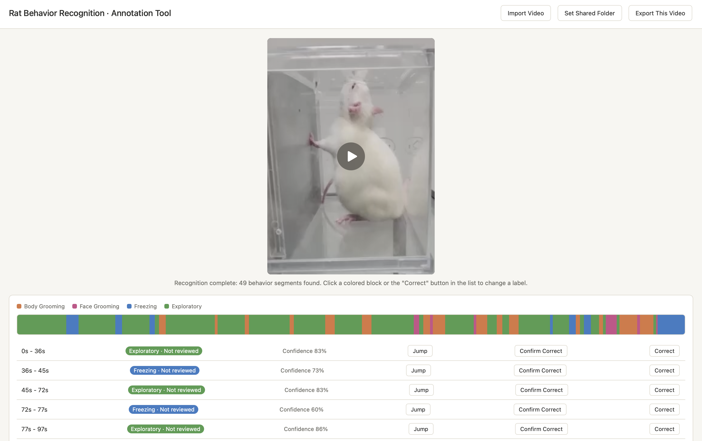

# Rodent Behavior Classification for Pain Research

A Python computer vision pipeline that classifies four behaviors in experimental rodent videos. The project also includes a desktop review application that lets researchers jump to predicted events, verify or correct labels, and export reviewed clips and behavioral summaries.

## My contribution

I designed and implemented the initial LSTM-based pipeline, then redesigned the feature extraction and classification stages around DINOv3 and a multilayer perceptron (MLP). I built the overlapping-window inference pipeline for long recordings and developed the desktop review application. This repository includes the research pipeline and the desktop application source.

## How the pipeline works

- **Clip classification.** The feature extractor samples 32 frames per clip, embeds them with DINOv3, and concatenates the per-feature mean and standard deviation across frames. The MLP uses that vector to predict one of four behavior classes.
- **Long-recording inference.** The model runs on 3-second windows with a 1-second stride. Each 1-second interval receives votes from windows that fully cover it. When vote counts tie, the script chooses the tied class with the highest sum of predicted probabilities across those windows.

## Desktop review application



Researchers can jump to a predicted segment, review its label and confidence score, confirm or correct the label, and export reviewed clips with a CSV manifest for the current video.

Start with [`desktop_app/api.py`](desktop_app/api.py) to see how the pywebview interface invokes Python inference, saves annotations, and exports reviewed clips. [`desktop_app/inference.py`](desktop_app/inference.py) runs sliding-window inference and merges adjacent intervals with the same predicted label into segments for the timeline.

## Code guide

| File | What to look for |
| --- | --- |
| [`window_inference_overlap_vote.py`](window_inference_overlap_vote.py) | Start here for long-video inference, vote aggregation, and timestamped JSON and CSV exports. See `build_voted_1s_results` and `majority_vote_with_prob_tiebreak`. |
| [`extract_features.py`](extract_features.py) | Frame sampling, DINOv3 feature extraction, and per-video feature caching. |
| [`train_mlp.py`](train_mlp.py) | Four-class MLP training, checkpoint selection on the validation set, and held-out evaluation with a confusion matrix and error analysis. |
| [`prepare_data.py`](prepare_data.py) | Label parsing and class-stratified train, validation, and test splits. |

## Running with project inputs

The scripts use paths relative to the repository root. The modeling scripts use Python 3.10 or later, PyTorch, Transformers with DINOv3 support, OpenCV, NumPy, and tqdm. You also need access to the [DINOv3 ViT-B/16 backbone](https://huggingface.co/facebook/dinov3-vitb16-pretrain-lvd1689m).

Install the Python dependencies from the repository root. Use a Transformers version that supports the linked DINOv3 model.

```bash
python -m pip install -r requirements.txt
```

### Training

Place labeled clips in `videos_1/` and `videos_2/`, following the filename conventions in `prepare_data.py`. The preparation script writes split manifests, and the feature extractor writes arrays to `features_v1/`.

```bash
python prepare_data.py
python extract_features.py
python train_mlp.py
```

### Long-video inference

Place the MLP checkpoint `best_mlp_by_val.pt` in the repository root and put input recordings in `long_videos/`.

```bash
python window_inference_overlap_vote.py
```

### Desktop application

Install the app's dependencies and launch it from the repository root.

```bash
cd desktop_app
python -m pip install -r requirements.txt
python main.py
```

Real model inference requires access to the DINOv3 backbone and a compatible trained MLP checkpoint at `desktop_app/resources/model_weights.pt` (relative to the repository root). If the checkpoint is absent, the app generates placeholder labels and confidence scores for UI testing. These outputs are illustrative.

Research recordings and trained model weights are excluded from the repository.

## Publication

Fan, Y., Terio, C., Zeng, Z., Wang, Q., Eliav, E., & Luo, J. *AI-powered rodent behavior recognition model for pain research*. Journal of Neuroscience Methods. [DOI](https://doi.org/10.1016/j.jneumeth.2026.110913)
